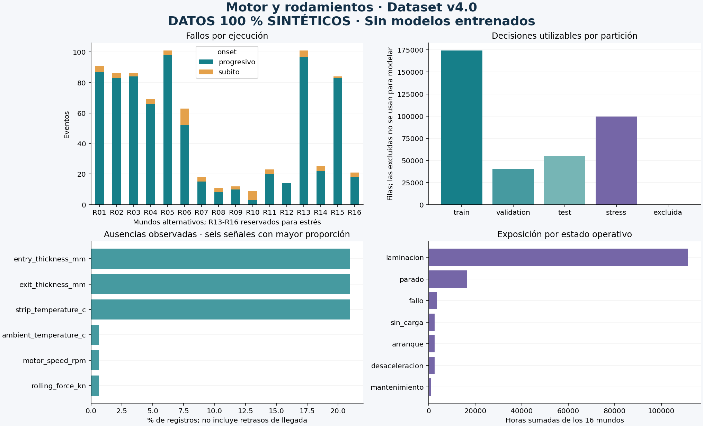

<p align="center"></p>

# Mantenimiento predictivo · Industria 4.0

### De una línea CSP simulada a un experimento auditable de motor y rodamientos

**Python · pandas · Parquet · PostgreSQL · Series temporales · Calidad de datos**

Proyecto personal de **Joseph** para investigar cómo anticipar fallos simulados y priorizar inspecciones. La referencia conceptual es el proceso de laminación en caliente de Sestao.

> **v4.0 · Dataset 100 % sintético.** XGBoost e Isolation Forest se entrenarán y evaluarán en otra fase. No hay calibración de Sestao ni evidencia de anticipación de averías reales o ahorro industrial. Los modelos base de v1/v2 son experimentos históricos.

<!-- release-status -->
**Dataset v4.0 publicado:** [descargar las dos partes y hashes](https://github.com/JsphLynx/ML-Predecir-Fallos-Maquinaria-Industrial-4.0/releases/tag/portfolio-v4.0). Código, ejemplos y los informes internos del paquete están incorporados.
<!-- /release-status -->

**[Lectura para reclutadores](docs/v4.0/PORTFOLIO.md) · [Código v4.0](versions/v4.0/src/) · [Informe de mejora](docs/reports/Informe_Mejora_Dataset_v4_0.pdf) · [Descargas](docs/DESCARGAS.md) · [English](docs/v4.0/RESUMEN_EN.md)**

## La pregunta y la decisión

¿Podemos detectar riesgo de fallo con tiempo para **priorizar una inspección**, sin saturar al responsable con falsas alertas? El trabajo cubre simulación, ingeniería de variables, contratos temporales, auditoría y preparación de evaluación. La eficacia predictiva está pendiente de medir.

## Qué contiene v4.0

| Dimensión | Entrega |
|---|---|
| Alcance | Una caja lógica con motor y apoyos DE/NDE por mundo; no siete cajas reales |
| Dataset | 16 mundos de 365 días; 1.681.920 lecturas y 560.640 decisiones |
| Frecuencia y objetivo | Telemetría 5 min; decisión 15 min; fallo funcional en las próximas 24 h |
| Contrato ML | 26 señales; 187 predictores numéricos y 4 categóricos |
| Mecánica | Geometría, fuerza, par, velocidades, potencia y corriente relacionadas |
| Calidad temporal | Latencia, ventanas causales, censura, purga y configuraciones con validez |
| Eventos | 814 fallos simulados; no historial real de averías |
| Evidencia original | 2.100 controles correctos; reproducción 94/94 archivos |
| Importación | 182/182 hashes coinciden; 90 originales en Git y 93 archivos de datos en ZIP |

Los controles de consistencia no son métricas predictivas. [Verificación de publicación](docs/VERIFICACION.md) y [modelo físico](versions/v4.0/docs/MODELO_FISICO.md).



## Cinco entregas, una evolución trazable

| Versión | Cambio principal | Evidencia |
|---|---|---|
| [v1](versions/v1/) | Exploración CSP y primer modelo base | Generación y resultados históricos |
| [v2](versions/v2/) | Ingeniería, Parquet, SQL y evaluación por episodios | Diccionario y metodología |
| [v3](versions/v3/) | Foco en motor y rodamientos | [Auditoría](docs/reports/auditoria_v3.pdf) |
| [v3.1](versions/v3.1/) | Correcciones y protocolo previo al entrenamiento | [Cierre](docs/reports/cierre_auditoria_v3_1.pdf) |
| [v4.0](docs/v4.0/README.md) | Contexto mecánico, configuración temporal y contratos de sensores | [Investigación Sestao–SMS](docs/reports/Informe_Investigacion_Sestao_SMS_Contraste_v3_1.pdf) y [mejora](docs/reports/Informe_Mejora_Dataset_v4_0.pdf) |

Se conservan los originales. No concatenar datasets ni interpretar diferencias de tasas de fallo como mejora de fiabilidad real. [Evolución](docs/EVOLUCION.md).

## Explorar la implementación

- **Negocio:** [problema y decisiones](docs/v4.0/PORTFOLIO.md).
- **Generación:** [simulador](versions/v4.0/src/01_generar_dataset.py), [física](versions/v4.0/src/fisica.py), [procedencia de parámetros](versions/v4.0/docs/procedencia_parametros.csv).
- **Datos:** [diccionario](versions/v4.0/docs/diccionario_datos.md), [contrato ML](versions/v4.0/ml/columnas_modelo.json), [ejemplos CSV](versions/v4.0/ejemplos_csv/).
- **PostgreSQL:** [DDL](versions/v4.0/sql/01_esquema.sql) y [consultas asof](versions/v4.0/sql/02_lecturas_asof.sql). Integración v4.0 con servidor pendiente.
- **Evaluación futura:** [protocolo](versions/v4.0/docs/PROTOCOLO_PREENTRENAMIENTO.md), [evaluador de alertas](versions/v4.0/src/protocolo_evaluacion.py). La verdad interna no es predictor.
- **Comunicación:** [informes](docs/reports/), [vídeos históricos v3.1](media/README.md), [síntesis de auditoría posterior](docs/v4.0/AUDITORIA_POSTERIOR.md).

## Comprobar el portafolio

```bash
git clone https://github.com/JsphLynx/ML-Predecir-Fallos-Maquinaria-Industrial-4.0.git
cd ML-Predecir-Fallos-Maquinaria-Industrial-4.0
python -m pip install -r versions/v4.0/requirements_auditoria.txt
python scripts/verificar_portfolio.py
python scripts/probar_protocolo_v40.py
```

Python 3.12. Los fixtures usan una copia temporal y no entrenan modelos. [Guía y Spyder](docs/REPRODUCIBILIDAD.md).

**Dataset completo:** descargar las dos partes desde [Releases](https://github.com/JsphLynx/ML-Predecir-Fallos-Maquinaria-Industrial-4.0/releases/tag/portfolio-v4.0), verificarlas y extraerlas en la misma carpeta fuera del clon. Los ZIP no se concatenan. El paquete contiene 183 archivos: el manifiesto y los 182 archivos protegidos por sus hashes. [Instrucciones](docs/DESCARGAS.md).

## Continuidad

Próxima fase: comparadores, XGBoost e Isolation Forest bajo el protocolo de v4.0. Después, API y dashboard. Windows/Spyder, integración PostgreSQL/Neon y validación industrial siguen pendientes. [Roadmap](docs/ROADMAP.md).

La documentación suplementaria que no está dentro de los ZIP se identifica expresamente en [PUBLICACION.md](docs/v4.0/PUBLICACION.md); no se presenta como incluida.

[Historial](CHANGELOG.md) · [Fuentes y límites](docs/FUENTES_Y_LIMITES.md) · [Catálogo por archivo](docs/catalogo_archivos_versiones.csv)

**Autor:** [Joseph · JsphLynx](https://github.com/JsphLynx). Desarrollado con asistencia de IA. Sin afiliación ni validación implícita por ArcelorMittal o SMS group.
