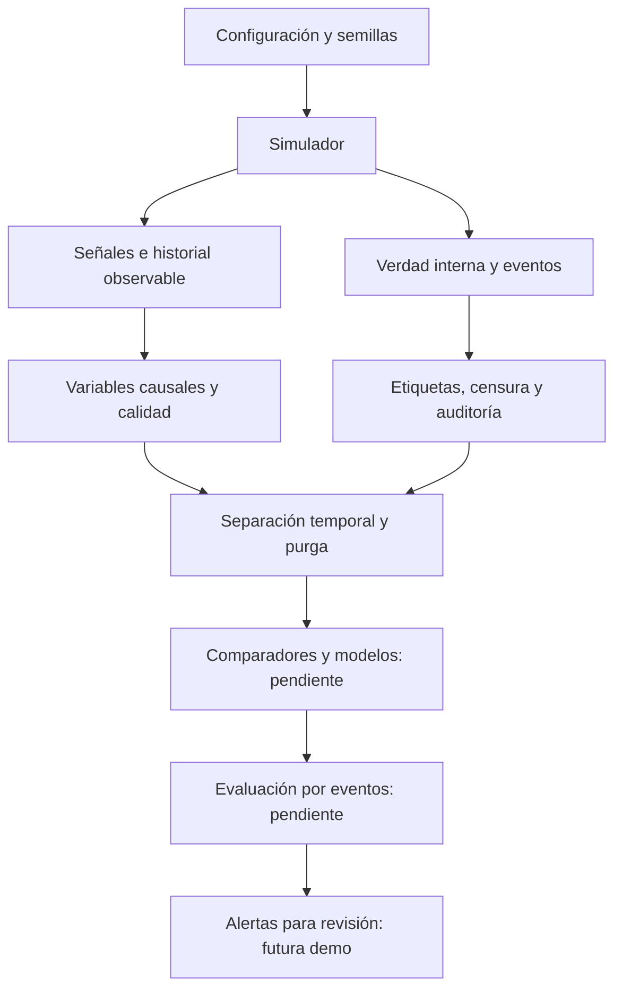

<p align="center"></p>

# Mantenimiento predictivo · Industria 4.0

### De una línea CSP simulada a un experimento auditable de motor y rodamientos

**Python · pandas · scikit-learn · Parquet · PostgreSQL · Series temporales**

Proyecto personal de **Joseph** para investigar cómo anticipar fallos simulados y priorizar inspecciones. Integra análisis de negocio, ingeniería de datos, modelado base, auditoría y comunicación técnica. Referencia conceptual: el proceso de colada y laminación en caliente de Sestao.

> **Datos 100 % sintéticos.** No son medidas de ArcelorMittal ni un gemelo digital validado. v1/v2 incluyen experimentos de modelos base. La entrega vigente **v3.1 está preparada para iniciar el entrenamiento de XGBoost e Isolation Forest**; todavía no acredita su rendimiento ni ahorro industrial.

> **v4.0 · incorporación en preparación:** el nuevo dataset está generado. [Consultar mejoras, evidencia y pendientes de publicación](docs/v4.0/README.md). Los archivos completos disponibles públicamente en Releases siguen siendo v1–v3.1; no se ha entrenado v4.0.

**[Resumen para reclutadores](docs/PORTFOLIO.md) · [Evolución](docs/EVOLUCION.md) · [Vídeos](media/README.md) · [Código v3.1](versions/v3.1/src/) · [Próximas fases](docs/ROADMAP.md)**

## La pregunta del proyecto

¿Podemos detectar un riesgo de fallo con suficiente anticipación para revisar el equipo, sin saturar al responsable con falsas alertas?

El proyecto evoluciona desde una simulación general de producción hasta un subsistema concreto: **motor + apoyo DE + apoyo NDE**. La decisión propuesta es priorizar una inspección. Los parámetros y mecanismos son supuestos explícitos del simulador.

## Cuatro entregas, una evolución trazable

| Versión | Qué aporta | Evidencia principal |
|---|---|---|
| [v1 · Exploración CSP](versions/v1/) | 19 equipos equivalentes, 90 días, CSV comprimido y primer modelo base | [Generación](versions/v1/resultados/resumen_generacion.json) · [Resultados](versions/v1/resultados/modelo_base.json) |
| [v2 · Ingeniería y evaluación](versions/v2/) | 18 meses, Parquet, modelo relacional, diccionario y comparación por episodios | [Metodología](versions/v2/docs/02_metodologia_y_uso.md) · [Modelo base](versions/v2/resultados/modelo_base.json) |
| [v3 · Motor y rodamientos](versions/v3/) | 8 mundos alternativos, calidad/latencia y fallo funcional a 24 h | [Migración](versions/v3/docs/01_auditoria_migracion.md) · [Auditoría](docs/reports/auditoria_v3.pdf) |
| [v3.1 · Correcciones y protocolo](versions/v3.1/) | 16 mundos, mantenimiento versionado, referencias IF separadas y pruebas PostgreSQL | [Cierre](docs/reports/cierre_auditoria_v3_1.pdf) · [Protocolo](versions/v3.1/docs/PROTOCOLO_PREENTRENAMIENTO.md) |

Las versiones originales se conservan. Cambian escenarios, horizontes y políticas; sus métricas **no son una comparación directa de mejora predictiva**. [Ver evolución y resultados históricos con sus límites](docs/EVOLUCION.md).

## Qué contiene la entrega vigente

| Contrato v3.1 | Valor documentado |
|---|---|
| Telemetría / decisiones | Cada 5 min / cada 15 min |
| Objetivo supervisado | Fallo funcional en las próximas 24 h |
| Escenario | 16 mundos alternativos de 365 días |
| Registros / decisiones / fallos | 1.681.920 / 560.640 / 404 |
| Validación histórica | 1.693 comprobaciones correctas; 0 fallidas |
| Regeneración histórica | 77/77 archivos idénticos por SHA-256 |
| XGBoost e Isolation Forest | Entrenamiento y evaluación pendientes |

Fuente: [informe de cierre](docs/reports/cierre_auditoria_v3_1.pdf) y [aceptación original](versions/v3.1/resultados/aceptacion_v31.json). Los recuentos son sintéticos. Las pruebas estructurales no son evidencia de eficacia industrial. [Verificación nueva de esta publicación](docs/VERIFICACION.md).

## Diseño del experimento



La verdad interna nunca se usa como predictor. La evaluación distinguirá detección por evento, falsas alertas, anticipación, cobertura e incertidumbre. Isolation Forest genera una puntuación de anomalía, no una probabilidad de fallo futuro.

## Explorar el trabajo

- **Negocio:** [problema y 19 fases](docs/history/business_data_project_original.md).
- **Datos:** [diccionario v3.1](versions/v3.1/docs/diccionario_datos.md), [catálogo completo con hashes](docs/catalogo_archivos_versiones.csv) y [distribución de datos](docs/DESCARGAS.md).
- **Código:** [generador](versions/v3.1/src/01_generar_dataset.py), [variables causales](versions/v3.1/src/02_construir_variables.py) y [evaluador de alertas](versions/v3.1/src/protocolo_evaluacion.py).
- **SQL:** [esquema](versions/v3.1/sql/01_esquema.sql), [consultas asof](versions/v3.1/sql/02_lecturas_asof.sql) y [evidencia PostgreSQL](versions/v3.1/resultados/postgresql_ejecutado.json).
- **Informes:** [arquitectura](docs/reports/arquitectura_subsistema.pdf), [EDA v3](docs/reports/eda_v3.pdf), [auditoría](docs/reports/auditoria_v3.pdf) y [cierre](docs/reports/cierre_auditoria_v3_1.pdf).
- **Comunicación:** [dos vídeos 1080p y fuentes editables](media/README.md).

## Comenzar

```bash
git clone https://github.com/JsphLynx/ML-Predecir-Fallos-Maquinaria-Industrial-4.0.git
cd ML-Predecir-Fallos-Maquinaria-Industrial-4.0
python -m pip install -r versions/v3.1/requirements.txt
python scripts/verificar_portfolio.py
python scripts/probar_protocolo.py
```

Usar Python 3.12, preferiblemente en un entorno virtual. Estos comandos verifican el material publicado y ejecutan fixtures del protocolo sin entrenar modelos. [Guía completa y Spyder](docs/REPRODUCIBILIDAD.md).

**Datos completos publicados:** [descargar v1, v2, v3 y v3.1 en GitHub Releases](https://github.com/JsphLynx/ML-Predecir-Fallos-Maquinaria-Industrial-4.0/releases/tag/portfolio-v3.1). Los cuatro ZIP originales conservan sus tamaños y SHA-256 verificados. Para continuar el proyecto, utilizar **v3.1**. [Descargas e integridad](docs/DESCARGAS.md).

## Estado del proyecto y continuidad

**Publicación del portafolio cerrada el 19/11/2026:** código, informes, vídeos y cuatro paquetes completos disponibles. El entrenamiento y la evaluación sintética de XGBoost e Isolation Forest se realizarán en otra fase.

Completado en las entregas: simulación, documentación, pruebas de datos, auditoría, correcciones y preparación de evaluación. Próximo: entrenar y comparar modelos bajo el protocolo congelado; después, desarrollar API y dashboard. Windows/Spyder, Neon y validación industrial siguen pendientes.

[Roadmap](docs/ROADMAP.md) · [Historial](CHANGELOG.md) · [Fuentes y limitaciones](docs/FUENTES_Y_LIMITES.md) · [English overview](docs/README_EN.md)

**Autor:** [Joseph · JsphLynx](https://github.com/JsphLynx). Proyecto personal desarrollado con asistencia de IA. Sin afiliación ni validación implícita por parte de ArcelorMittal.
