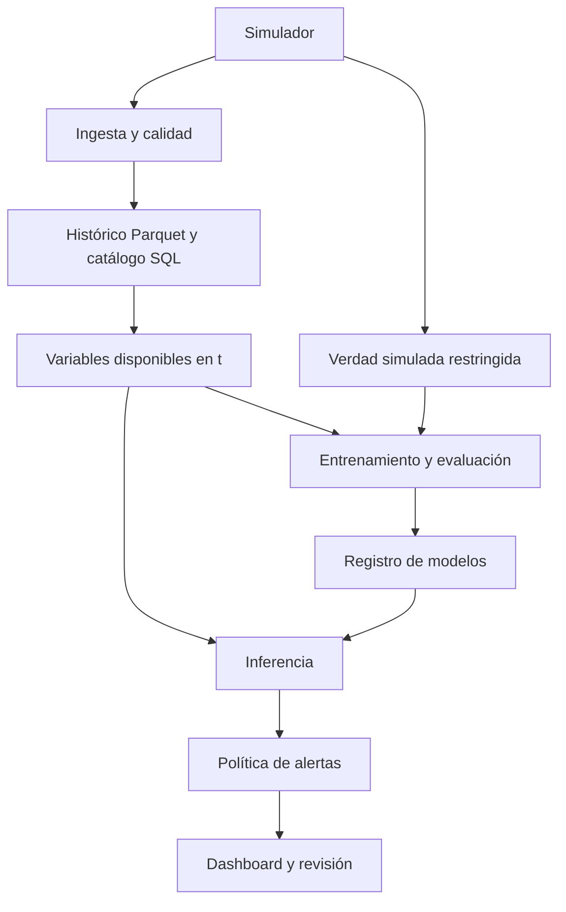

# Subsistema de mantenimiento predictivo del tren de laminación

**Proyecto:** Prjct_ML_Predecir_Fallos_Maquinaria_Industrial · Joseph  
**Versión:** 1.0 de arquitectura · 3 de noviembre de 2026  
**Estado:** diseño técnico para demostración con datos sintéticos. No es un sistema instalado ni validado en ArcelorMittal Sestao.

## 1. Decisión y fundamento documental

**Unidad inicial: el conjunto motor y apoyos de rodamiento de una caja representativa del tren.** Se conserva la jerarquía de toda la línea para ampliar después, pero el primer modelo supervisado predice un fallo del conjunto seleccionado. No se construye un modelo para toda la acería ni uno distinto por cada sensor.

**Pregunta empresarial:** ¿qué accionamiento merece una inspección prioritaria por riesgo de fallo en las próximas 24 horas y qué señales justifican esa prioridad? Las 24 horas son una decisión de demostración, no una necesidad confirmada de la planta.

| Clasificación | Evidencia o decisión | Consecuencia para el diseño |
|---|---|---|
| Hecho documental | La Declaración Ambiental 2024, publicada en junio de 2025, describe horno túnel, laminador con siete cajas y bobinado. Página PDF 11 [F1]. | Usar este proceso como contexto físico documentado. No afirmar que sea un inventario actualizado a noviembre de 2026. |
| Hecho documental histórico | La ficha comercial de 2013 indica espesor de 1–15 mm, ancho de 845–1550 mm con restricciones y peso máximo de 28 t [F2]. | Referencia histórica para diseñar productos sintéticos; no combinar libremente todos los extremos ni afirmar vigencia comercial. |
| Discrepancia | El estudio de eficiencia describe slabs de 220–250 mm y un tren semicontinuo con desbastador, páginas PDF 39–41 [F3]. | No trasladar esa configuración al diseño de Sestao: no queda reconciliada con la fuente corporativa. |
| Decisión del proyecto | Una caja lógica DEMO-C01; un motor lógico y dos apoyos DE/NDE. | Son identificadores y componentes simulados, no el inventario real de una caja concreta. |
| Desconocido | Tipo y potencia de motores, transmisión, rodamientos, sensores, históricos de fallo y mantenimiento. | Mantener esos atributos pendientes o parametrizados; no inventar datos de fabricante. |

**Resultado empresarial que se puede demostrar:** trazabilidad señal → evaluación → alerta → revisión → cierre. El ahorro económico y la reducción de averías reales no pueden demostrarse con este dataset.

**Entrega de esta versión:** límites físicos, catálogo de señales, arquitectura de software, modelo relacional lógico, especificación del simulador, entrenamiento, evaluación y criterios de aceptación. El generador, el entrenamiento y el dashboard se especifican aquí; todavía no están implementados en esta entrega.

<!-- PAGEBREAK -->

## 2. Arquitectura física y límites del subsistema

Contexto documentado: colada continua → horno túnel → laminador de siete cajas → enfriamiento y bobinado [F1, p. 11]. La ubicación exacta de sensores y la transmisión de potencia no están documentadas en las fuentes revisadas.

| Nivel | Identificador de demostración | Función y alcance |
|---|---|---|
| Planta | DEMO-ACB | Contexto de Sestao; no representa conexión con sus sistemas. |
| Línea | DEMO-LAM | Tren de laminación en caliente. |
| Caja | DEMO-C01 | Caja representativa sin equivalencia confirmada con una caja real. |
| Conjunto | DEMO-C01-DRV01 | Unidad para predicción, priorización y registro de intervenciones. |
| Motor | DEMO-C01-M01 | Velocidad, carga eléctrica y comportamiento térmico. |
| Apoyo DE | DEMO-C01-BRG-DE | Rodamiento supuesto del lado de accionamiento. |
| Apoyo NDE | DEMO-C01-BRG-NDE | Rodamiento supuesto del lado opuesto al accionamiento. |

DE significa drive end; NDE, non-drive end. Los dos apoyos con rodamientos constituyen una hipótesis del demostrador; deberán revisarse si el motor real utiliza otra solución de apoyo. Los rodamientos de los cilindros de laminación son otros activos y quedan fuera del primer modelo.

**Dentro:** salud del conjunto motor-apoyos; relación con carga, velocidad, producto y estado operativo; fallos e intervenciones simulados. Lubricación y refrigeración se incluyen como variables de contexto del motor cuando proceda.

**Fuera inicialmente:** predicción de fallos de reductores, husillos, cilindros, hidráulica, horno, bobinadoras y calidad superficial. Su existencia o diseño concreto no se deduce del motor lógico. La arquitectura admite añadir estas familias con contratos y validaciones propios.

| Escenario de simulación | Evidencia observable propuesta | Tratamiento |
|---|---|---|
| Degradación de apoyo | Evolución de vibración y temperatura condicionada por velocidad y carga. | Evento del conjunto; localización DE/NDE disponible en la verdad simulada. |
| Lubricación deficiente | Cambios térmicos y vibratorios; señal de lubricación solo si se configura. | Mecanismo que puede acelerar degradación, no etiqueta deducida de un único umbral. |
| Problema térmico del motor | Temperatura del devanado, corriente y refrigeración contextual. | Fallo funcional simulado con incertidumbre; no diagnóstico eléctrico certificado. |
| Desalineación o desequilibrio | Alteración persistente de descriptores vibratorios. | Anomalía; no identificarla con certeza sin instrumentación y análisis suficientes. |
| Fallo súbito | Evento con precursores débiles o inexistentes. | Medir las omisiones; no diseñar el simulador para que todo sea predecible. |
| Avería de sensor | Señal congelada, salto, deriva o ausencia. | Incidencia de calidad separada de fallo de maquinaria. |

Estas asociaciones son hipótesis de simulación, no firmas diagnósticas verificadas en la planta.

<!-- PAGEBREAK -->

## 3. Contrato de señales y variables

**Grano analítico propuesto:** una fila por conjunto, ejecución de simulación e instante de un minuto. Todas las marcas de tiempo se guardan en UTC; el dashboard presenta Europe/Madrid. La agregación utiliza únicamente datos disponibles hasta el instante de decisión.

| Grupo | Variables propuestas | Unidad o tipo |
|---|---|---|
| Identidad y tiempo | run_id, assembly_id, observed_at, available_at, quality_code | ID, timestamp, categoría |
| Apoyos DE/NDE | vibration_velocity_rms, acceleration_rms, acceleration_kurtosis, bearing_temperature | mm/s, m/s², adimensional, °C |
| Motor | speed, current_rms, winding_temperature, load_ratio | rpm, A, °C, fracción |
| Contexto térmico | ambient_temperature; cooling_status si existe en el escenario | °C, categoría |
| Lubricación | lubrication_status; pressure solo con circuito configurado | categoría; bar |
| Producto y proceso | coil_id, steel_family, target_thickness, width, rolling_state | ID, categoría, mm, mm, categoría |
| Historia disponible | run_hours_since_service, starts_last_24h, known_service_type | h, recuento, categoría |
| Calidad | missing_fraction, sensor_stale, out_of_range, regime_supported | fracción, booleanos |

**Regímenes:** parado, arranque, marcha sin carga, laminación, desaceleración y mantenimiento. El patrón esperado varía por régimen. Un cambio de producto o velocidad no debe etiquetarse automáticamente como avería.

**Instrumentación:** en el demostrador se simulan descriptores de vibración, no ondas reales. Un dato por minuto no permite reconstruir frecuencias de defecto. No se calculan BPFO/BPFI ni bandas espectrales verificables sin geometría de rodamiento, velocidad y adquisición adecuadas. La frecuencia de adquisición real queda pendiente del diseño de instrumentación.

**Disponibilidad temporal:** observed_at indica cuándo ocurrió la medida; available_at, cuándo estuvo disponible. La unión para inferencia exige ambas fechas ≤ tiempo de decisión. Se registran retrasos, unidades, sensor, algoritmo de agregación y versión del contrato.

**Ventanas propuestas:** 5 min, 30 min y 4 h; media, dispersión, pendiente, máximos y cambios respecto a la referencia del régimen. No usar ventanas centradas. Imputación y normalización se ajustan con entrenamiento; nunca rellenar hacia atrás usando el futuro.

**Reglas de calidad:** claves únicas, unidades compatibles, valores físicos imposibles rechazados, ausencias conservadas y señalizadas. Para la demo: exigir ≥80 % de cobertura en señales esenciales de la ventana de 30 min y ausencia de congelación detectada. Es un umbral de ingeniería provisional; se versiona y se somete a sensibilidad. Datos insuficientes producen estado «sin evaluación», nunca «saludable».

<!-- PAGEBREAK -->

## 4. Arquitectura de datos y aplicación

**Implementación prevista:** Python con scripts separados ejecutables en Spyder; Parquet para históricos; PostgreSQL para trazabilidad; una API FastAPI y una interfaz Streamlit en la primera aplicación. Esto evita mantener dos interfaces durante el piloto. La base de datos puede alojarse en Neon cuando se implemente, sin requerir ahora una conexión.

| Componente | Entrada y salida | Responsabilidad |
|---|---|---|
| Simulador versionado | Configuración + semilla → señales, contexto y verdad simulada | Crear trayectorias reproducibles y escenarios diferenciados. |
| Ingesta y calidad | Señales → observaciones aceptadas, descartes y alertas de datos | Validar esquema, tiempo, unidades y duplicados; conservar procedencia. |
| Constructor de variables | Observaciones disponibles → snapshot inmutable | Mismo cálculo de variables en entrenamiento y en reproducción temporal. |
| Entrenamiento | Snapshots + etiquetas autorizadas → modelos y métricas | Comparar baseline, XGBoost e Isolation Forest; registrar divisiones y versiones. |
| Inferencia | Snapshot → riesgo, anomalía o abstención | No consultar etiquetas ni estados ocultos del simulador. |
| Política de alertas | Resultados + calidad + estado operativo → alerta consolidada | Persistencia, agrupación, prioridad y supresión durante mantenimiento. |
| API y dashboard | Datos operativos → consulta y revisión humana | Mostrar evidencia, registrar decisión y mantener auditoría. |

**Fronteras:** Parquet conserva datos históricos particionados por ejecución y fecha; PostgreSQL almacena inventario, eventos, catálogo de archivos, ejecuciones, resultados y alertas. La verdad del simulador reside en un esquema separado con acceso exclusivo para generación y evaluación.

**Contratos de API previstos:** GET /assets; GET /assets/{id}/timeline; GET /predictions/latest; GET /alerts; POST /alerts/{id}/reviews. La revisión exige identidad, fecha, decisión y comentario. La API no permite escribir en PLC ni ordenar paradas.

**Operación:** ingesta y predicción por lotes de un minuto simulado; ejecución manual al inicio, programable después. Escrituras idempotentes por run_id + assembly_id + instante + versión. Reprocesar crea otra versión de resultados, sin borrar evidencias anteriores.

**Seguridad prevista:** roles separados de ingesta, entrenamiento, servicio y lectura; credenciales en variables de entorno; TLS en conexiones remotas; API autenticada para revisiones. Un eventual acceso a datos de fábrica sería de lectura y con arquitectura OT/IT aprobada por la planta. No forma parte de esta entrega.

<!-- PAGEBREAK -->

## 5. Modelo relacional lógico en PostgreSQL

Este es un diseño lógico, no un esquema SQL desplegado. PK = clave primaria; FK = clave foránea. Los valores de sensores masivos se mantienen en Parquet; el catálogo SQL conserva su localización e integridad.

| Esquema / tabla | Clave y relaciones | Contenido esencial |
|---|---|---|
| catalog.asset | PK asset_id; FK parent_asset_id → asset | Jerarquía, tipo, nombre, is_synthetic, fuente y atributos pendientes. |
| catalog.sensor | PK sensor_id; FK asset_id → asset | Variable, unidad, ubicación lógica, vigencia, método de medida simulado. |
| data.simulation_run | PK run_id | Semilla, versión generador, configuración, inicio/fin y hash. |
| data.partition | PK partition_id; FK run_id | URI Parquet, tipo de datos, fechas, filas, esquema y SHA-256. |
| ops.production_segment | PK segment_id; FK run_id, assembly_id | Intervalo de régimen y producto; inicio y fin explícitos. |
| ops.event | PK event_id; FK run_id, asset_id | Inicio, fin, detección, tipo, gravedad, procedencia y grado de confirmación. |
| ops.maintenance | PK work_order_id; FK asset_id; event_id opcional | Apertura, ejecución, cierre, actuación, resultado y horas de parada. |
| ml.feature_snapshot | PK snapshot_id; FK run_id, assembly_id | cutoff_at, available_at_max, versión, calidad y URI/fila de variables. |
| ml.model_run | PK model_run_id | Algoritmo, contrato, ventanas, partición, métricas, artefacto y umbrales. |
| ml.prediction | PK prediction_id; FK snapshot_id, model_run_id | Riesgo o score, horizonte, estado de evaluación y explicación. |
| ops.alert | PK alert_id; FK assembly_id, prediction_id | Apertura, última observación, prioridad, estado y política aplicada. |
| ops.alert_review | PK review_id; FK alert_id; work_order_id opcional | Autor, fecha, decisión, comentario y acción vinculada. |
| sim_truth.latent_state | PK run_id + asset_id + timestamp | Degradación oculta y parámetros internos; prohibidos como predictores. |
| sim_truth.target | PK snapshot_id + horizon_hours | Etiqueta, event_id, elegibilidad, motivo de censura y versión. |

**Restricciones necesarias:** FK coherentes; instantes finales posteriores a iniciales; probabilidad entre 0 y 1 cuando exista; unicidad de predicción por snapshot/modelo; cobertura entre 0 y 1; URI e integridad de archivo verificables. El score de anomalía no se guarda en el campo probabilidad.

**Relaciones temporales:** un segmento de producción es válido en [inicio, fin); no debe solaparse con otro del mismo conjunto y ejecución. Eventos e intervenciones sí pueden coincidir y deben conservar su causa. Diferenciar ocurrencia del fallo, detección y disponibilidad del registro evita introducir información futura.

**Trazabilidad mínima de una alerta:** alerta → predicción → snapshot → versión de variables → particiones de origen; y predicción → modelo → dataset/partición temporal/métricas. La revisión enlaza la orden de trabajo y el cierre. Cada unión incluye la ejecución sintética, para no mezclar mundos simulados.

<!-- PAGEBREAK -->

## 6. Especificación del dataset sintético

**Propuesta de tamaño, ajustable:** 180 días × 8 ejecuciones independientes × 1 conjunto × 1 registro/minuto = 2.073.600 filas analíticas antes de filtros. Las ocho ejecuciones son mundos alternativos del mismo diseño, no ocho motores identificados en Sestao. No implican un número garantizado de fallos.

**Generación secuencial:** calendario y productos → régimen/carga → evolución de degradación oculta → señales observadas → eventos y mantenimiento → etiquetas futuras. Las variables internas se conservan únicamente en sim_truth.

Un esquema conceptual es D(t+1) = máximo(0, D(t) + desgaste(carga, temperatura, régimen) + perturbación). Las señales dependen del estado operativo, de D y de ruido autocorrelacionado. La probabilidad de fallo depende de la degradación y del esfuerzo, con una componente de choques súbitos. Las funciones, distribuciones y coeficientes se versionan como supuestos; no constituyen una calibración física de Sestao.

| Mecanismo | Variación que debe incluir | Error de diseño que se evita |
|---|---|---|
| Operación | Paradas, arranques, productos y velocidades distintas. | Confundir trabajo exigente normal con avería. |
| Degradación | Trayectorias no idénticas, velocidades de desgaste y precursores débiles. | Reconocer una cuenta atrás determinista. |
| Fallo | Modos progresivos y súbitos; observación imperfecta. | Aprender etiquetas creadas con un solo umbral observable. |
| Sensores | Ruido correlacionado, pérdidas en bloques, deriva y congelación. | Usar señales artificialmente limpias o confundir sensor y máquina. |
| Mantenimiento | Sustitución, mejora parcial y mantenimiento sin fallo. | Reiniciar siempre la salud de forma perfecta. |
| Cambio de dominio | Otras cargas, niveles de ruido y funciones de degradación. | Validar solo nuevas semillas del mismo mecanismo generador. |

**Etiqueta principal:** y24(t)=1 si un fallo funcional del conjunto comienza en (t, t+24 h]; y24(t)=0 si se observa todo ese horizonte, el conjunto sigue bajo seguimiento y no ocurre el evento. Las 24 h son tiempo de calendario. Excluir filas durante fallo, mantenimiento o fuera de los regímenes elegibles. Si hay pérdida de seguimiento, fin de simulación o intervención preventiva antes de completar el horizonte, la etiqueta es desconocida/censurada, no 0.

**Intervenciones:** el objetivo inicial mide fallos observados antes de una intervención preventiva. No estima qué habría ocurrido sin mantenimiento. Conservar las filas censuradas y su motivo para detectar sesgo de selección. Una extensión causal o de supervivencia requeriría otro diseño.

**Prohibido como entrada:** fecha del próximo fallo, tiempo restante real, degradación oculta, identificador de escenario/fallo, reparaciones futuras y etiquetas. La historia de mantenimiento solo puede usarse si ya era conocida en t.

**Reproducibilidad:** semilla maestra y subsemillas; versión de código y dependencias; manifiesto de configuración; hashes; diccionario y metadatos. La aceptación exige distribuciones y casos revisables, no maximizar artificialmente las métricas del modelo.

<!-- PAGEBREAK -->

## 7. Modelos, evaluación y explicabilidad

**Tres referencias:** (1) baseline de persistencia/tendencia por régimen; (2) XGBoost para riesgo de fallo del conjunto en 24 h; (3) Isolation Forest para anomalías multivariantes. El detector se entrena sobre periodos de referencia considerados sanos y cubre los regímenes admitidos. Un score de anomalía no es una probabilidad de fallo [F5].

**Una salida supervisada inicial:** fallo funcional del conjunto. No añadir de entrada modelos independientes de motor, DE y NDE: fragmentarían los eventos disponibles. El apoyo con señales alteradas puede mostrarse como indicio, sin afirmar una causa diagnosticada. La clasificación por modo de fallo se añade solo si hay eventos suficientes y evaluación propia.

**División propuesta:** ejecuciones 1–6 con cortes temporales comunes 60 % entrenamiento, 20 % validación y 20 % prueba; ejecuciones 7–8 reservadas completas para estrés con cambios de parámetros/mecanismo. Dentro de entrenamiento, ajuste con validación temporal expansiva. Dividir por fechas, no por filas concatenadas de varios activos.

**Evitar fuga temporal:** purgar entrenamiento cuyas etiquetas alcancen el periodo siguiente; dejar inicialmente un margen conservador de 28 h (horizonte 24 h + ventana máxima 4 h) en los límites de los bloques. No repartir un episodio de degradación/fallo entre conjuntos; excluirlo del límite cuando sea necesario. El histórico previo puede alimentar variables de prueba si realmente estaba disponible. TimeSeriesSplit ofrece gap, pero no resuelve por sí mismo agrupación por activo ni episodios [F4].

**Selección:** preprocesado ajustado solo en entrenamiento; selección de umbrales y calibración en validación, con subdivisión temporal o predicciones fuera de muestra. Prueba final intacta. Reponderación de clases, si se usa, obliga a revisar calibración. No aplicar sobremuestreo antes de dividir.

| Métrica | Qué mide y cómo interpretarla |
|---|---|
| PR-AUC / average precision | Discriminación con fallos escasos; acompañar de prevalencia y número de eventos. |
| Recall por evento | Fracción de fallos con al menos una alerta válida entre 24 h y 1 h antes del inicio. La hora mínima es provisional. |
| Precisión de alertas | Episodios de alerta asociados a un fallo dentro de 24 h / episodios evaluables. Ventanas censuradas no cuentan como falsas. |
| Falsas alertas / 1000 h | Episodios falsos por exposición operativa elegible, no por filas. |
| Anticipación | Tiempo entre primera alerta asociada e inicio del fallo; separar fallos no detectados. |
| Brier y calibración | Correspondencia del riesgo con frecuencia observada dentro del simulador. |
| Cobertura | Porcentaje de instantes elegibles evaluados, abstenciones y causas. |

**Explicación:** contribuciones SHAP de XGBoost, principales señales y tendencias previas. Las contribuciones explican la salida del modelo, no prueban causalidad; en clasificación binaria la suma se interpreta en el margen del modelo, no sumando puntos porcentuales de riesgo [F6].

**Conclusión válida:** rendimiento sobre escenarios sintéticos definidos, con incertidumbre por eventos/ejecuciones. No extrapolar cifras a maquinaria real. Fallos súbitos y regímenes nuevos deben permanecer en el informe, aunque empeoren el resultado.

<!-- PAGEBREAK -->

## 8. Alertas y dashboard de mantenimiento

**Orden de decisión:** validar datos → comprobar régimen → calcular riesgo y anomalía → aplicar persistencia → consolidar alerta → revisión humana. Riesgo y anomalía se muestran separados; no se promedian en un «índice de salud» sin validación.

| Situación | Estado y acción de demostración |
|---|---|
| Datos insuficientes o sensor anómalo | «Sin evaluación» e incidencia de calidad; no emitir diagnóstico de máquina. |
| Régimen no cubierto | «Fuera del dominio del modelo»; registrar y revisar. |
| Riesgo supera umbral validado de forma persistente | Alerta predictiva para inspección prioritaria, con evidencia y plazo. |
| Solo anomalía persistente | «Comportamiento inusual»; revisión técnica sin afirmar fallo próximo. |
| Riesgo y anomalía persistentes | Mayor evidencia para priorizar inspección; no equivalen a fallo confirmado. |
| Equipo parado por fallo o en mantenimiento | Suprimir nuevas alertas predictivas repetidas; mantener registro del evento. |

**Política inicial ajustable:** persistencia de 3 de los últimos 5 resultados válidos dentro de 5 minutos; una alerta abierta por conjunto y tipo; nuevas señales actualizan esa alerta. Cierre humano o cierre automático propuesto tras 30 min válidos bajo el umbral de salida. Ese umbral será menor que el de entrada para evitar oscilación. Si faltan datos, suspender la evaluación; no cerrar como recuperación. Todos los parámetros son decisiones de demo que se validan.

**Prioridad:** riesgo validado + criticidad declarada + persistencia + disponibilidad de evidencia. No asignar costes, criticidad o plazos como si hubieran sido aprobados por la planta. Con un único conjunto la demo muestra una cola de incidencias; la comparación entre máquinas se habilita al ampliar activos.

**Pantallas previstas:**

1. Resumen: estado del conjunto, alertas abiertas, calidad, última actualización y etiqueta visible «DATOS SINTÉTICOS».
2. Detalle: motor, DE/NDE, carga/régimen, evolución de señales, riesgo y score de anomalía en escalas separadas.
3. Investigación: señales que influyen en el modelo, historial previo y cambios de producto o mantenimiento.
4. Gestión: reconocer, revisar, vincular una intervención y cerrar con resultado y responsable.
5. Validación: baseline frente a modelos, falsos avisos, fallos omitidos, anticipación y resultados por escenario.

**Caso de uso de aceptación:** una degradación simulada del apoyo DE eleva señales bajo carga comparable; el modelo produce riesgo persistente; el sistema abre una alerta, conserva snapshot/modelo/fuentes, muestra evidencia y registra revisión e intervención. La mejora posterior depende del tipo de reparación simulado; no se fuerza siempre un retorno perfecto.

**Límite operativo:** el sistema propone revisión; no sustituye protecciones, interbloqueos ni procedimientos de mantenimiento. El dashboard no presenta RUL ni diagnósticos por modo de fallo hasta que existan modelos y pruebas específicos.

<!-- PAGEBREAK -->

## 9. Construcción, aceptación y evolución

| Paso | Entregable previsto | Criterio de finalización |
|---|---|---|
| A. Arquitectura | Este documento y su versión editable. | Alcance, hechos/supuestos, contratos y evaluación definidos. Completado en esta entrega. |
| B. Generación | Scripts Spyder, configuración, Parquet, diccionario, manifiesto. | Reproducibilidad, claves válidas, escenarios y censura verificados. Pendiente. |
| C. Análisis | Calidad, EDA y análisis por régimen/evento. | Revisar coherencia, ausencias, cambios de dominio y posibles fugas. Pendiente. |
| D. Modelado | Baseline, XGBoost, Isolation Forest, explicaciones. | Particiones congeladas, métricas por evento y trazabilidad completa. Pendiente. |
| E. Aplicación | Esquema SQL, API, dashboard y reproducción temporal. | Completar el recorrido señal → alerta → revisión → cierre. Pendiente. |
| F. Validación | Casos de prueba, informe y manual. | Fallos de sensor, reinicio, duplicados, permisos y recuperación comprobados. Pendiente. |

**Puertas de calidad:** cero entradas futuras en snapshots; ninguna verdad latente accesible al servicio; resultados reproducibles con misma configuración; pruebas de pérdida de datos y regímenes nuevos; comparación contra baseline a igual presupuesto de falsas alertas. No fijar un objetivo de accuracy del 95 % ni prometer una mejora antes de entrenar.

**Si faltan fallos para evaluar:** informar tamaño insuficiente, ampliar exposición simulada y documentar el cambio; no aumentar artificialmente la separación entre normales y fallos para conseguir una buena curva. No declarar generalización a activos distintos usando solo semillas diferentes.

**Evolución:** primero replicar el contrato en otras cajas lógicas y comprobar transferencia; después incorporar transmisión/reductores o apoyos de cilindros como familias independientes; finalmente extender a bobinadoras u otros subsistemas con sus propios modos, sensores y criterios. Tener siete cajas documentadas no demuestra que sus accionamientos sean intercambiables.

**Pendientes para una aplicación real:** inventario y esquemas OEM; sensorística y frecuencias de adquisición; catálogo de fallos; horarios y régimen de trabajo; registro de mantenimiento; coste de paradas; plazo útil de aviso; derechos de acceso e integración. Sin ello, el resultado seguirá siendo una demostración metodológica.

<!-- PAGEBREAK -->

## 10. Fuentes y alcance de lectura

- **[F1] ArcelorMittal Sestao, Declaración Ambiental 2024**, junio de 2025, archivo aportado `ArcelorMittalSestao-DeclaracionAmbiental2024.pdf`. Páginas PDF 1 y 11: fecha, proceso y siete cajas. Se aplicó OCR a páginas 1–14 y se comprobó visualmente la página 11. No se presenta como revisión integral de sus 35 páginas.
- **[F2] ArcelorMittal Sestao de un vistazo**, archivo aportado `arcelormittal-sestao-de-un-vistazo.pdf`, una página, versión V5 con copyright 2013. Texto extraído para rangos históricos de producto. No acredita configuración de motores.
- **[F3] Javier Pindado Cebrián, Estudio de eficiencia de una acería en Sestao**, UC3M, archivo aportado `Estudio_Eficiencia_Aceria_Arcelor_Mittal.pdf`. Lectura dirigida de páginas PDF 38–43 (paginación impresa 36–41). La descripción del tren no se adopta como inventario real actual.
- **[F4] scikit-learn, TimeSeriesSplit:** https://scikit-learn.org/stable/modules/generated/sklearn.model_selection.TimeSeriesSplit.html — particiones temporales y parámetro gap.
- **[F5] scikit-learn, IsolationForest:** https://scikit-learn.org/stable/modules/generated/sklearn.ensemble.IsolationForest.html — detector y score de anomalías.
- **[F6] XGBoost, Prediction:** https://xgboost.readthedocs.io/en/stable/prediction.html — contribuciones y formatos de predicción.

Las fuentes web se consultaron el 03/11/2026. No se añaden datos de producción actuales ni costes. Los valores de ventanas, horizonte, tamaño, cobertura y política de alertas son decisiones propuestas para la demo; deberán constar en una configuración versionada al implementar.
