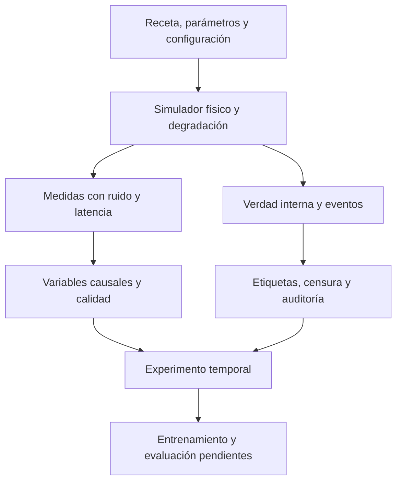

# Arquitectura y contrato v4.0

Síntesis del informe de mejora, páginas 2–6. Esta documentación no sustituye a los archivos originales del generador, ya incorporados en `versions/v4.0/`.

## Separación de responsabilidades



| Capa del paquete | Grano / función | Restricción |
|---|---|---|
| data/telemetria | Mundo, conjunto, instante de 5 min | Respetar available_at |
| ml/features | Mundo, conjunto, decisión de 15 min | Solo lista explícita de predictores |
| ml/targets | y24, censura, partición y selectores | No son entradas del modelo |
| sim_truth/fisica | Referencia limpia, eficiencia efectiva | Privada para auditoría |
| sim_truth/estado_latente | Daño y salud ocultos | Prohibidos como predictores |
| data/configuraciones | Intervalos y versiones de equipo/control/sensor | No anticipar configuraciones futuras |
| data/mantenimiento | Intervención e instante de conocimiento | Cierre solo tras disponibilidad |

## Magnitudes distintas

- `motor_speed_rpm`: giro del motor.
- `roll_speed_rpm`: giro de los cilindros equivalentes.
- `strip_speed_m_s`: velocidad de salida de banda.
- `strip_temperature_c`: temperatura de banda; no temperatura de devanado.
- `production_segment_id`: segmento contiguo; no bobina física.

## Relaciones del modelo mínimo

```text
h_entrada = h_salida / (1 - reducción)
longitud_contacto = sqrt(radio × diferencia_espesor_en_m)
fuerza = tensión_fluencia × ancho_en_m × longitud_contacto × factor_forma
par_cilindros_equivalente = 2 × fuerza × longitud_contacto × brazo_relativo
rpm_motor = relación_transmisión × rpm_cilindro
omega = 2 × pi × rpm / 60
potencia_mecánica_motor = par_motor × omega_motor
potencia_eléctrica = potencia_mecánica / eficiencia
corriente = potencia_eléctrica / (sqrt(3) × tensión_línea_línea × factor_potencia)
```

Convertir kN, kNm y kW a unidades coherentes antes de comprobar identidades. La potencia mecánica del motor incluye pérdidas de transmisión y auxiliares equivalentes. La fuerza es una aproximación cuasiestática, no una solución de elasticidad, mordida o tensión entre cajas.

**Supuestos didácticos documentados:** radio 0,35 m; tensión 3.300 V; factor de potencia 0,90; potencia nominal 2.000 kW; transmisión 6,0/5,7; eficiencia de transmisión 0,97. No son datos de placa de Sestao.

## Dos dominios y señal vibratoria

El segundo dominio empieza el día 183 y cambia transmisión, eficiencia nominal y ganancia de sensores. Es un cambio virtual; el daño no se reinicia y no se atribuye una modernización real a la planta. Las ventanas se reinician por configuración.

La cadencia de 300 s no es frecuencia de adquisición de una onda. RMS y curtosis se generan como descriptores; frecuencia original, banda, ventana, eje y montaje no se inventan. Los máximos de telemetría con defectos no son límites físicos del equipo.

## Evaluación futura

Ventanas 30/240 min; purga 28 h; separación temporal 60/20/20 en R01–R12; R13–R16 para estrés. y24 nulo no es cero. Alertas: 3 de 5 decisiones; aviso útil de 1 a 24 h; presupuesto de 1 falsa alerta por 1.000 horas operativas. Son reglas experimentales.

Isolation Forest principal usa referencia observable; la referencia ideal latente solo sirve para sensibilidad. Su score no es probabilidad de fallo. Mantener denominadores de eventos y horas aunque existan abstenciones.
